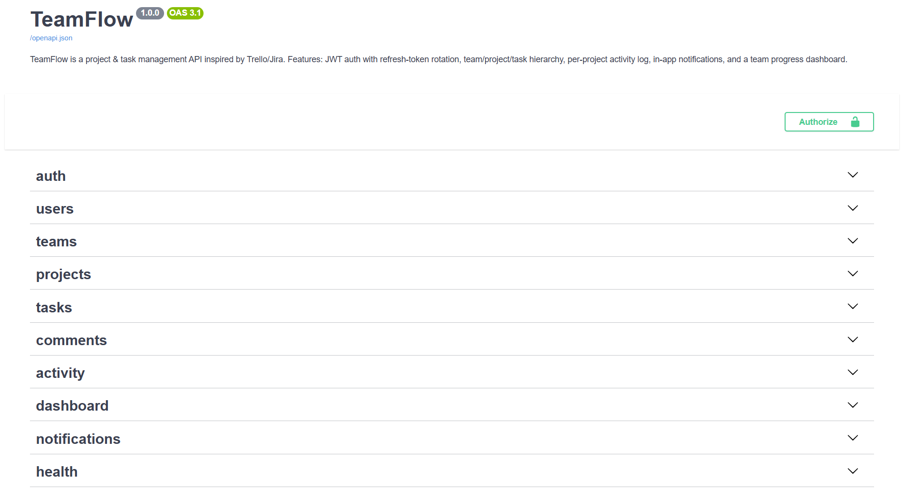
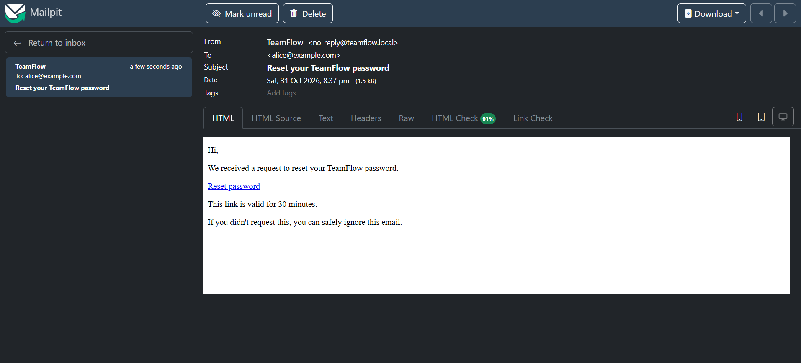
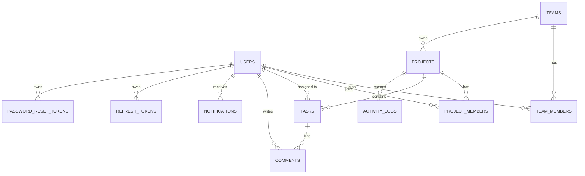

# TeamFlow — Backend API

A production-grade project & task management REST API built with **Python 3.10**, **FastAPI**, **PostgreSQL**, **SQLAlchemy 2.0**, and **Alembic**. Inspired by Trello/Jira.


---

## Tech Stack

| Layer | Technology |
|-------|-----------|
| Framework | FastAPI |
| ORM | SQLAlchemy 2.0 (mapped columns) |
| Database | PostgreSQL 16 |
| Migrations | Alembic |
| Validation | Pydantic v2 |
| Auth | Argon2id · JWT (HS256) · Refresh token rotation |
| Background jobs | Celery + Redis |
| Email (dev) | Mailpit (local SMTP server with web UI) |
| Rate limiting | SlowAPI |
| Testing | pytest + httpx |
| Linting | Ruff |
| Containerization | Docker + Docker Compose |
| CI | GitHub Actions |

---

## Architecture

```
app/
├── core/          # Config, logging, middleware, rate limiting, security utils, Celery app
├── common/        # Shared exceptions, dependencies, schemas (Page[T], UserSummary)
├── db/            # SQLAlchemy session factory, declarative base
└── modules/
    ├── auth/          # Login, register, JWT, refresh rotation, password reset (+ email task)
    ├── users/         # GET /me, PATCH /me
    ├── teams/         # Teams + member management (role-based)
    ├── projects/      # Projects + project member management
    ├── tasks/         # Tasks with filters, pagination, status updates
    ├── comments/      # Task comments
    ├── activity/      # Immutable activity log per project
    ├── dashboard/     # Team & project progress stats
    └── notifications/ # Per-user in-app notifications
```

**Request flow:** `Router → Service → Repository → SQLAlchemy ORM → PostgreSQL`

**Transaction ownership:** Repositories only `flush()`. Services own `commit()` — guaranteeing that multi-step operations (task created + activity logged + notification queued) land atomically in one transaction.

**Background jobs:** Slow work (like sending email) never blocks a request. The service commits first, then enqueues a Celery task:

```
API (forgot_password) → Redis (queue) → Celery worker → SMTP → Mailpit / real provider
```

---

## Permission Model

| Role | Scope | Can do |
|------|-------|--------|
| `ADMIN` | Team | Everything: manage members, projects, tasks |
| `PROJECT_MANAGER` | Team | Create/update projects and tasks; add project members |
| `MEMBER` | Team | View and work on tasks they're assigned to |

The user who creates a team becomes its first `ADMIN` automatically; other roles are granted by an admin.

Projects also have their own member list. Managers/admins see all projects in a team; regular members see only the projects they're assigned to.

---

## Key Design Decisions

- **Refresh token rotation with family revocation:** Every refresh invalidates the old token and issues a new one. Token reuse (replay attack) revokes the entire family for that user.
- **Argon2id** for password hashing — the current OWASP recommendation over bcrypt.
- **Account lockout** after configurable failed attempts (`MAX_FAILED_LOGINS`, `LOCKOUT_MINUTES`).
- **No user enumeration via `forgot_password`:** the endpoint always returns the same status and body, whether or not the email exists. (Response *timing* is not fully equalized; see limitations.)
- **Password reset by email, off the request path:** the API responds immediately; a Celery worker sends the email (with automatic retry and backoff). If the broker is down, the failure is logged and the public response is unchanged. The reset token is never written to logs in production.
- **Race condition protection:** Admin role demotions and member removals use `SELECT ... FOR UPDATE` to prevent a concurrent request from leaving a team with zero admins.
- **LIKE injection protection:** Search queries escape `%`, `_`, and `\` before building LIKE predicates.

---

## Running Locally

### Option A: Docker (everything)

Prerequisites: Docker + Docker Compose.

```bash
git clone https://github.com/KhaledAli1234/teamflow.git
cd teamflow
docker compose up -d --build
```

The `api` container runs `alembic upgrade head` on startup, so no manual migration step is needed.

| Service | URL / Port |
|---------|-----------|
| API | http://localhost:8000 (docs at `/docs`) |
| Mailpit (inbox UI) | http://localhost:8025 |
| PostgreSQL | localhost:5433 |
| Redis | localhost:6379 |

The compose file starts `db`, `redis`, `mailpit`, `api` (health-checked via `GET /health`), and a Celery `worker`.
Compose sets its own environment variables (including a dev `SECRET_KEY`); change them before any real deployment.

### Option B: Run the API on your machine

```bash
cp .env.example .env
# Edit .env: set SECRET_KEY to a random 32+ char string

python -m venv .venv
.venv\Scripts\activate        # Windows
# source .venv/bin/activate   # macOS/Linux

pip install -r requirements.txt

# Start only the infrastructure in Docker
docker compose up -d db redis mailpit

alembic upgrade head
uvicorn app.main:app --reload
```

In a second terminal, start the Celery worker:

```bash
# Windows (the default pool is not supported, use solo)
celery -A app.core.celery_app worker --loglevel=info --pool=solo

# macOS/Linux
celery -A app.core.celery_app worker --loglevel=info
```

### Try the password-reset email

1. Register a user, then call `POST /api/v1/auth/forgot-password` with their email.
2. The API responds immediately; the worker log shows the task being received and succeeding.
3. Open http://localhost:8025 to see the email and its reset link.

---

### Quick tour (curl)

```bash
API=http://localhost:8000/api/v1

# 1. Register and log in (login is an OAuth2 form: username = email)
curl -X POST $API/auth/register -H "Content-Type: application/json" \
  -d '{"email":"alice@example.com","full_name":"Alice","password":"S3cure-pass!"}'
TOKEN=$(curl -s -X POST $API/auth/login \
  -d "username=alice@example.com&password=S3cure-pass!" | python -c "import sys,json; print(json.load(sys.stdin)['access_token'])")
AUTH="Authorization: Bearer $TOKEN"

# 2. Create a team (the caller becomes its ADMIN), a project, and a task
curl -X POST $API/teams -H "$AUTH" -H "Content-Type: application/json" -d '{"name":"Backend Team"}'
curl -X POST $API/teams/1/projects -H "$AUTH" -H "Content-Type: application/json" -d '{"name":"Website"}'
curl -X POST $API/projects/1/tasks -H "$AUTH" -H "Content-Type: application/json" \
  -d '{"title":"Design schema","priority":"high"}'

# 3. Move the task forward and check the dashboard
curl -X PATCH $API/tasks/1/status -H "$AUTH" -H "Content-Type: application/json" -d '{"status":"in_progress"}'
curl $API/teams/1/dashboard -H "$AUTH"
```

Interactive docs: http://localhost:8000/docs

## Screenshots

| Swagger UI | Password-reset email (Mailpit) |
|---|---|
|  |  |

---

## Data Model



---

## Running Tests

```bash
# Requires the test database to exist: psql -c "CREATE DATABASE teamflow_test;"
pip install -r requirements-dev.txt
ruff check app tests
pytest -v --cov=app
```

The suite has 126 test functions and uses a dedicated `teamflow_test` database and truncates all tables after each test — no data leakage between tests. The Celery task is mocked in every test, so the suite needs neither Redis nor an SMTP server. Task arguments, the email template, and the full link-to-reset flow are covered by dedicated tests.

---

## Environment Variables

See [`.env.example`](.env.example) for all variables with comments. Key ones:

| Variable | Default | Description |
|----------|---------|-------------|
| `DATABASE_URL` | — | PostgreSQL DSN (required) |
| `SECRET_KEY` | — | JWT signing key, min 32 chars (required) |
| `ENVIRONMENT` | `development` | `development` or `production` (production rejects placeholder keys) |
| `ACCESS_TOKEN_EXPIRE_MINUTES` | `15` | Short-lived JWT |
| `REFRESH_TOKEN_EXPIRE_DAYS` | `7` | Refresh token lifetime |
| `MAX_FAILED_LOGINS` | `5` | Attempts before lockout |
| `LOCKOUT_MINUTES` | `15` | Lockout duration |
| `RATE_LIMIT_ENABLED` | `true` | Toggle rate limiting |
| `PASSWORD_RESET_EXPIRE_MINUTES` | `30` | Reset link lifetime |
| `FRONTEND_URL` | `http://localhost:3000` | Base URL used in reset links |
| `CORS_ORIGINS` | `["http://localhost:3000"]` | Allowed origins |
| `REDIS_URL` | `redis://localhost:6379/0` | Celery broker and result backend |
| `SMTP_HOST` / `SMTP_PORT` | `localhost` / `1025` | SMTP server (Mailpit in dev) |
| `SMTP_USER` / `SMTP_PASSWORD` | empty | SMTP credentials (real provider) |
| `SMTP_USE_TLS` | `false` | Enable STARTTLS |
| `EMAIL_FROM` | `TeamFlow <no-reply@teamflow.local>` | Sender address |

---

## API Overview

| Resource | Endpoints |
|----------|-----------|
| Health | GET /health |
| Auth | POST /register, /login, /refresh, /logout, /logout-all, /forgot-password, /reset-password, /change-password |
| Users | GET /users/me, PATCH /users/me |
| Teams | CRUD /teams, /teams/{id}/members |
| Projects | CRUD /teams/{id}/projects, /projects/{id}/members |
| Tasks | CRUD /projects/{id}/tasks, PATCH /tasks/{id}/status |
| Comments | CRUD /tasks/{id}/comments |
| Activity | GET /projects/{id}/activity |
| Dashboard | GET /teams/{id}/dashboard, /projects/{id}/progress |
| Notifications | GET /notifications, PATCH /notifications/{id}/read, POST /notifications/read-all |

All list endpoints are paginated (`?page=1&page_size=20`).

---

## CI/CD

GitHub Actions workflow (`.github/workflows/ci.yml`):
1. Spins up PostgreSQL as a service container
2. Installs `requirements-dev.txt` and lints with `ruff check app tests`
3. Runs `alembic upgrade head`
4. Asserts `alembic check` (no undetected schema drift)
5. Runs `pytest -v --cov=app`

---

## Known Limitations / Future Work

- **Email provider:** Emails are verified against Mailpit in development. For production, point the `SMTP_*` variables at a real provider (SendGrid, SES, ...) and enable `SMTP_USE_TLS`.
- **Broker outage handling:** If Redis is down, the enqueue failure is logged and the request still returns the normal response, but the email is not sent and not retried later. A persistent outbox (or retry job) is a natural next step.
- **Rate limiter:** Uses in-memory SlowAPI storage — not suitable for multi-worker deployments. Redis is now part of the stack, so switching to `storage_uri="redis://..."` is straightforward.
- **More background jobs:** Only the password-reset email is a task so far (welcome email and notification emails are natural next candidates).
- **File uploads:** No attachment support on tasks (common PM feature).
- **Superuser role:** No system-level admin; roles are team-scoped only.
- **Soft delete:** All deletes are hard deletes with cascade.
- **Email verification:** Registration does not verify the email address.
- **Access token revocation:** Logout and password change revoke refresh tokens, but an already-issued access token stays valid until it expires (15 minutes by default).
- **Task status:** Any status can be set from any other; there is no enforced workflow.
- **Registration enumeration:** `POST /register` reports that an email is already registered.
- **Response timing:** `forgot_password` returns the same body for known and unknown emails, but timing is not equalized.

---

## License

MIT, see [LICENSE](LICENSE).
